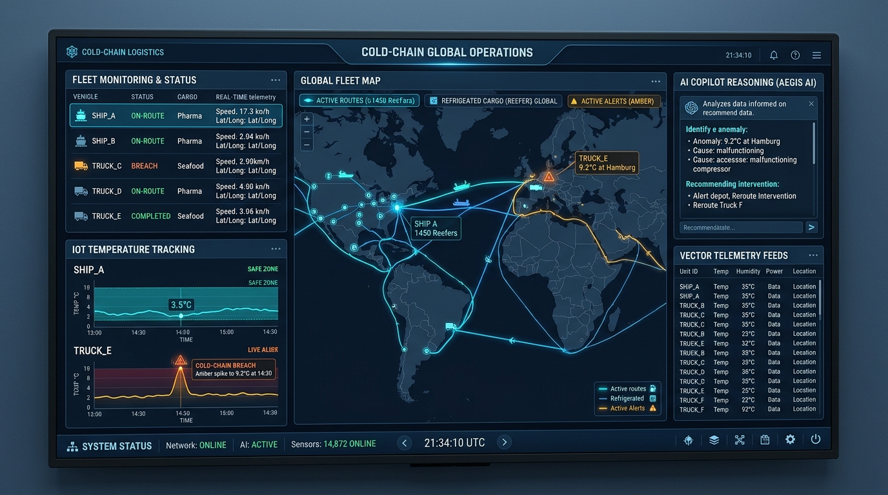
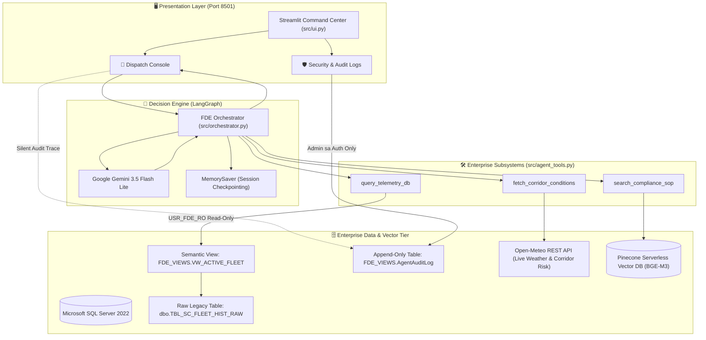

# 🧊 Cold-Chain Logistics FDE Enterprise AI Assistant



[](https://www.python.org/)
[](https://langchain-ai.github.io/langgraph/)
[](https://www.microsoft.com/en-us/sql-server)
[](https://www.pinecone.io/)
[](https://ai.google.dev/)
[](https://streamlit.io/)
[](https://ubuntu.com/)

An enterprise-grade **Forward Deployed Engineering (FDE)** decision-support platform for cold-chain fleet dispatchers. The system bridges legacy transactional telemetry databases (SQL Server), real-time external REST APIs (Open-Meteo), and compliance vector knowledge bases (Pinecone) into an auditable **LangGraph** autonomous state machine.

---

## 🏛️ System Architecture



---

## 🚀 Key Project Phases & Technical Milestones

### Phase 0: Legacy Database Simulation & Ingestion
* **Containerized Infrastructure:** Spun up Microsoft SQL Server 2022 (`mcr.microsoft.com/mssql/server:2022-latest`) locally via Docker.
* **Messy Schema Ingestion ([`scripts/ingest_legacy_data.py`](file:///scripts/ingest_legacy_data.py)):** Ingested **32,065 historical telemetry records** from raw CSV data, intentionally simulating dirty 2000s enterprise schemas with cryptic abbreviations:
  * `TS_UTC`, `V_LAT`, `V_LON`, `IOT_TEMP_VAL_C`, `CGO_COND_CD`, `RISK_CLS_TXT`, `DELAY_PROB_DEC`, `PRT_CNG_LVL`, `RT_RSK_IDX`.

### Phase 1: Security Hardening & Semantic Layer
* **Security Script ([`scripts/setup_security_and_view.sql`](file:///scripts/setup_security_and_view.sql)):**
  1. **Semantic View (`FDE_VIEWS.VW_ACTIVE_FLEET`):** Virtual abstraction translating legacy abbreviations into clean English business metrics (`Timestamp`, `Latitude`, `Current_Temperature_C`, `Cargo_Condition_Code`, `Delay_Probability`).
  2. **Least Privilege Role (`USR_FDE_RO`):** Dedicated agent login with `GRANT SELECT` **only** on the semantic view.
  3. **Explicit Deny Guardrails:** Strictly enforced `DENY SELECT ON dbo.TBL_SC_FLEET_HIST_RAW` and `DENY INSERT, UPDATE, DELETE, ALTER ON SCHEMA::dbo` to eliminate LLM mutation and hallucination risks.

### Phase 2: Vector Store SOP Knowledge Base
* **Document Ingestion ([`scripts/ingest_sop_pinecone.py`](file:///scripts/ingest_sop_pinecone.py)):**
  * Polymorphic document parser supporting Markdown, PDF, CSV, and Excel assets.
  * Extracted and chunked [`data/policy/Cold_Chain_Incident_SOP_v2.md`](file:///data/policy/Cold_Chain_Incident_SOP_v2.md) defining critical temperature breach protocols (0.0°C–4.0°C for perishables) and port congestion diversion rules.
  * Embedded and upserted vectors into Pinecone (`fde-sop-index-local`, 1024-dim) with local incremental MD5 hash caching.

### Phase 3: Core FDE Agent Tools
* **Implementation ([`src/agent_tools.py`](file:///src/agent_tools.py)):**
  * `query_telemetry_db`: Read-only scoped query tool connecting to `FDE_VIEWS.VW_ACTIVE_FLEET` via `USR_FDE_RO`.
  * `fetch_corridor_conditions`: Queries live Open-Meteo REST API for real-time temperature, wind speed, and computed corridor congestion scores.
  * `search_compliance_sop`: Vector similarity search against compliance SOPs stored in Pinecone.

### Phase 4: LangGraph Multi-Turn Orchestrator
* **State Machine ([`src/orchestrator.py`](file:///src/orchestrator.py)):**
  * Built using LangGraph `StateGraph`, `ToolNode`, `tools_condition`, and `MemorySaver`.
  * Integrated **Google Gemini 3.5 Flash Lite** (with multi-provider fallbacks for OpenAI, DeepSeek, and local Ollama Qwen2.5:7b).
  * Enforced structured business output format via [`src/prompts/system_prompt.txt`](file:///src/prompts/system_prompt.txt):
    1. *Executive Summary*
    2. *Telemetry & Environment Analysis Table*
    3. *Required Action Plan & SOP Compliance Citations*
  * **Verified Tests:**
    * **"Domino Effect" Test:** Chained SQL query + live weather lookup + SOP retrieval for an active sub-zero anomaly in the Los Angeles corridor.
    * **"Restraint" Test:** Zero-tool conversational reasoning for general dispatcher protocol inquiries.

### Phase 5: Streamlit Dispatch Console & Audit Governance
* **Dashboard ([`src/ui.py`](file:///src/ui.py)):**
  * **🧊 Dispatch Console:** Multi-turn chat interface with live tool execution tracing (Intent Recognized, Generated Input JSON, Raw Output payloads).
  * **🛡️ Security & Audit Logs:** Append-only database logging into `FDE_VIEWS.AgentAuditLog` with a secure administrative authentication gate (`sa`).

### Phase 6: Production Cloud Deployment (Ubuntu Linux + Systemd)
* Production deployment architecture on an Ubuntu server:
  * Official Microsoft ODBC Driver 18 Linux repository & development libraries.
  * Isolated Python 3.12 virtual environment.
  * Background **systemd** service daemon ensuring continuous uptime and automatic restart upon failure.

---

## 📦 Project Directory Structure

```plaintext
cold-chain-logistics-FDE-Project/
├── assets/
│   └── banner.jpg                       # Architecture & operations banner
├── data/
│   ├── cache/
│   │   └── ingestion_hash_cache.json    # Incremental vector sync cache (gitignored)
│   ├── policy/
│   │   └── Cold_Chain_Incident_SOP_v2.md# Enterprise SOP compliance rules
│   └── raw/
│       └── dynamic_supply_chain_logistics_dataset.csv  # 32,065 historical records
├── Misc/
│   └── Materials/                       # Business deck & technical design doc
├── scripts/
│   ├── ingest_legacy_data.py            # Legacy CSV -> MSSQL raw ingestion
│   ├── ingest_sop_pinecone.py           # Multi-format SOP -> Pinecone pipeline
│   └── setup_security_and_view.sql      # Semantic view, RBAC roles, Audit table
├── src/
│   ├── prompts/
│   │   └── system_prompt.txt            # Business analytical prompt template
│   ├── agent_tools.py                   # SQL, Open-Meteo REST API, Pinecone tools
│   ├── orchestrator.py                  # LangGraph multi-agent state machine
│   └── ui.py                            # Streamlit Command Center & Audit Explorer
├── .env.example                         # Environment configuration template
├── .gitignore                           # Production git exclusion rules
└── requirements.txt                     # Pinned project dependencies
```

---

## ⚙️ Environment Configuration

Copy `.env.example` to `.env` and fill in your credentials:

```bash
cp .env.example .env
```

| Variable | Description | Default / Example |
|---|---|---|
| `SQL_SERVER_HOST` | Hostname/IP of SQL Server | `localhost` |
| `SQL_SERVER_PORT` | Port for SQL Server | `1433` |
| `SQL_ADMIN_USER` | High-privilege admin account for initial setup | `sa` |
| `SQL_ADMIN_PASSWORD` | Password for admin account | `FdeEnterprisePass123!` |
| `SQL_AGENT_USER` | Scoped read-only login for AI agent | `USR_FDE_RO` |
| `SQL_AGENT_PASSWORD` | Scoped password for AI agent | `AgentPassword2026!` |
| `PINECONE_API_KEY` | Pinecone Cloud API Key | `pcsk_...` |
| `Embeddings_model` | Embedding provider (`LOCAL` or `OPENAI`) | `LOCAL` |
| `Local_Embedding_Model` | HuggingFace embedding model identifier | `BAAI/bge-m3` |
| `Agent_llm` | Reasoner LLM (`GEMINI`, `OPENAI`, `DEEPSEEK`, `OLLAMA`) | `GEMINI` |
| `Gemini_Model` | Gemini model name | `gemini-3.5-flash-lite` |
| `GEMINI_API_KEY` | Google Gemini API Key | `AQ...` |

---

## 🛠️ Local Development Quickstart

### 1. Start SQL Server Container
```bash
docker run --platform linux/amd64 -e "ACCEPT_EULA=Y" \
  -e "MSSQL_SA_PASSWORD=FdeEnterprisePass123!" \
  -p 1433:1433 --name legacy-mssql -d mcr.microsoft.com/mssql/server:2022-latest
```

### 2. Set Up Virtual Environment & Dependencies
```bash
uv venv --python 3.12 .venv
source .venv/bin/activate
uv pip install -r requirements.txt
```

### 3. Ingest Data & Configure Security
```bash
# Ingest historical dataset into MSSQL
python scripts/ingest_legacy_data.py

# Apply semantic view, USR_FDE_RO role, and Audit table
docker exec -i legacy-mssql /opt/mssql-tools18/bin/sqlcmd \
  -S localhost -U sa -P "FdeEnterprisePass123!" -d master -C < scripts/setup_security_and_view.sql

# Ingest SOP policies into Pinecone Vector DB
python scripts/ingest_sop_pinecone.py
```

### 4. Launch the Streamlit Dispatch Console
```bash
# On macOS (linking OpenSSL 3):
DYLD_LIBRARY_PATH=/opt/homebrew/opt/openssl@3/lib streamlit run src/ui.py

# On Linux / Windows:
streamlit run src/ui.py
```

---

## 🌐 Production Cloud Deployment (Ubuntu Linux + Systemd)

Follow these steps to deploy on an Ubuntu Linux cloud virtual machine (e.g., AWS EC2, Azure VM, GCP Compute Engine):

### Step 1: System Packages & Repository Setup
```bash
sudo apt update && sudo apt install -y python3-pip python3-venv git curl gpg
cd /home/ubuntu
git clone https://github.com/lokesh-repaka/cold-chain-logistics-FDE-Project.git
cd cold-chain-logistics-FDE-Project
```

### Step 2: Install Microsoft ODBC Driver 18 on Ubuntu
```bash
# Add Microsoft GPG repository key
curl -fsSL https://packages.microsoft.com/keys/microsoft.asc | sudo gpg --dearmor -o /usr/share/keyrings/microsoft-prod.gpg

# Add Microsoft SQL Server Ubuntu repository
curl -fsSL https://packages.microsoft.com/config/ubuntu/$(lsb_release -rs)/prod.list | sudo tee /etc/apt/sources.list.d/mssql-release.list

# Update apt and install msodbcsql18 and development headers
sudo apt-get update
sudo ACCEPT_EULA=Y apt-get install -y msodbcsql18 unixodbc-dev
```

### Step 3: Python Environment & Dependencies
```bash
python3 -m venv venv
source venv/bin/activate
pip install -r requirements.txt
```

### Step 4: Configure Background Systemd Service
Create the service unit file:
```bash
sudo nano /etc/systemd/system/streamlit.service
```

Paste the following unit configuration:
```ini
[Unit]
Description=Streamlit Cold-Chain Dispatch Console
After=network.target

[Service]
User=ubuntu
WorkingDirectory=/home/ubuntu/cold-chain-logistics-FDE-Project
ExecStart=/home/ubuntu/cold-chain-logistics-FDE-Project/venv/bin/streamlit run src/ui.py --server.port=8501 --server.address=0.0.0.0
Restart=always
RestartSec=5

[Install]
WantedBy=multi-user.target
```

### Step 5: Register & Start the Service
```bash
# Reload systemd manager configuration
sudo systemctl daemon-reload

# Enable service to automatically launch on boot
sudo systemctl enable streamlit

# Start the service
sudo systemctl start streamlit

# Verify running status
sudo systemctl status streamlit
```

Your Streamlit Command Center is now permanently hosted and accessible at:
```
http://<YOUR-SERVER-PUBLIC-IP>:8501
```

---

## 🛡️ Enterprise Governance & Audit Verification

All user interactions, agent thoughts, tool parameter inputs, and generated action plans are automatically committed to the database in real time:

```sql
SELECT TOP 5 
    LogID, 
    Timestamp, 
    SessionID, 
    NodeExecuted, 
    ToolName, 
    SUBSTRING(Content, 1, 100) AS ContentPreview
FROM FDE_VIEWS.AgentAuditLog
ORDER BY Timestamp DESC;
```

Access to this table is governed by database permissions:
* **AI Agent (`USR_FDE_RO`):** Granted **INSERT only** (cannot tamper with or read historical logs).
* **Enterprise Admin (`sa`):** Granted **SELECT & Full Control** through the authenticated Security Tab in the Command Center.

---

## 📄 License
This project is licensed under the MIT License. Enterprise compliance assets and SOP templates are for operational simulation purposes.
